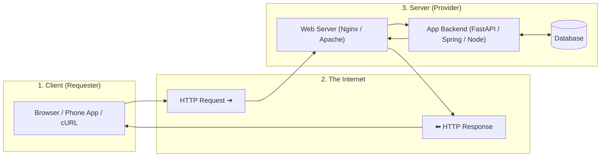
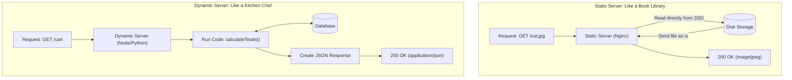
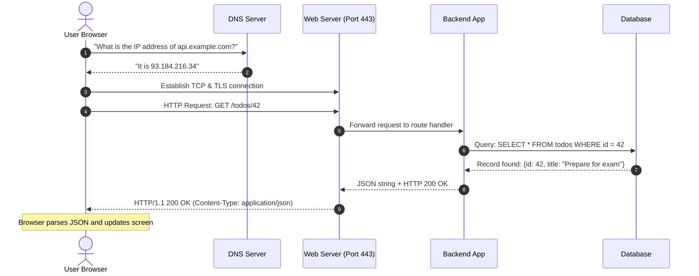
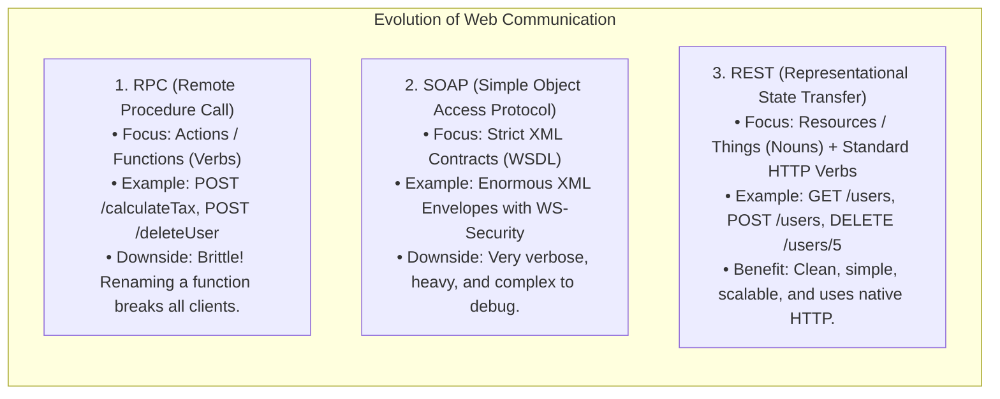
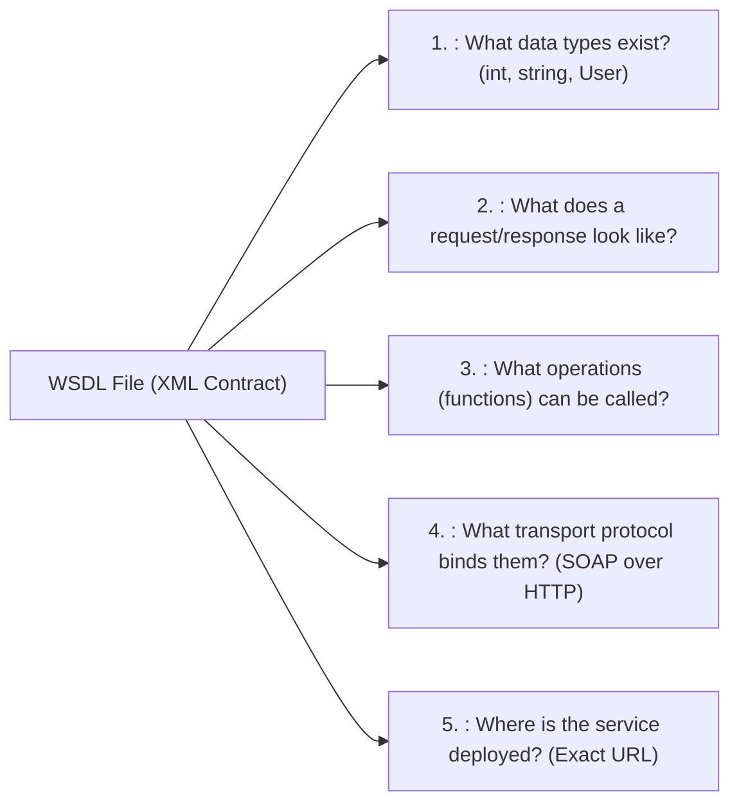
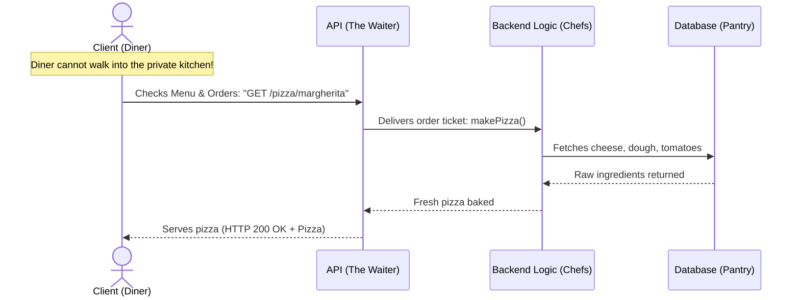

# SWE 4537 — Server Programming Notes

**Course:** SWE 4537: Server Programming  
**Department:** Department of Computer Science and Engineering (CSE), Islamic University of Technology (IUT)  
**Instructors:** Ishmam Tashdeed | Asaduzzaman Herok  
**Source Materials:** [[Lecture-1.pdf]] (Client & Server, Digital Addresses, HTTP) & [[Lecture-2.pdf]] (Web Services, Web APIs, REST, MVC)

---

## Quick Navigation / Table of Contents
- [[#1. The Client-Server Architecture]]
  - [[#1.1 What is a Web Client?]]
  - [[#1.2 Web Server: Hardware vs. Software]]
  - [[#1.3 Static vs. Dynamic Web Servers]]
  - [[#1.4 Web Applications: Frontend vs. Backend]]
  - [[#1.5 End-to-End Client-Server Flow]]
- [[#2. Digital Addressing: How Machines Find Each Other]]
  - [[#2.1 IP Addresses (Machine Identity)]]
  - [[#2.2 Port Numbers (Service Identity)]]
  - [[#2.3 Network Sockets]]
  - [[#2.4 Anatomy of a URL]]
- [[#3. The HTTP Protocol: The Web's Common Language]]
  - [[#3.1 Key Characteristics of HTTP]]
  - [[#3.2 Structure of an HTTP Message]]
  - [[#3.3 HTTP Request Anatomy]]
  - [[#3.4 HTTP Response Anatomy]]
  - [[#3.5 HTTP Status Codes at a Glance]]
- [[#4. Web Services & Machine Communication]]
  - [[#4.1 Web App vs. Web Service]]
  - [[#4.2 The 3 Communication Paradigms: RPC, SOAP, REST]]
  - [[#4.3 SOAP & The WSDL Contract]]
  - [[#4.4 The Restaurant Analogy (Making APIs Intuitive)]]
- [[#5. REST (Representational State Transfer) Architecture]]
  - [[#5.1 The 6 Guiding Rules (Fielding's Constraints)]]
  - [[#5.2 REST vs. RPC: Nouns vs. Verbs]]
  - [[#5.3 RESTful API Design: Collections vs. Single Items]]
  - [[#5.4 HTTP Methods Matrix: Safe vs. Idempotent]]
  - [[#5.5 Resources vs. Representations (Content Negotiation)]]
  - [[#5.6 Statelessness & Horizontal Scalability]]
- [[#6. Structuring APIs: The MVC Pattern]]
  - [[#6.1 The "Big Messy File" Problem]]
  - [[#6.2 The Three MVC Layers]]
  - [[#6.3 Step-by-Step Request Lifecycle in MVC]]
  - [[#6.4 Why Use MVC?]]

---

## 1. The Client-Server Architecture

> [!NOTE]
> **Core Concept in Plain Words:**  
> The internet runs on teamwork between two roles:
> - **The Client** asks for information or actions (e.g., "Show me my profile").
> - **The Server** listens, does the heavy lifting, and returns the result (e.g., "Here is your profile data").



### 1.1 What is a Web Client?
A **Web Client** is any software application that requests resources from a web server and displays or uses them.

*   **What it does:**
    1.  **Builds requests:** Translates what the user clicks or types into a valid HTTP request.
    2.  **Sends requests:** Sends the request across the internet to the server's IP address.
    3.  **Parses responses:** Reads the status code, headers, and body received from the server.
    4.  **Renders or consumes:** Browsers render HTML/CSS on screen; mobile apps convert JSON data into native UI elements.
*   **Real-World Examples:**
    *   *Browsers:* Google Chrome, Safari, Firefox.
    *   *Mobile Apps:* Instagram app, Spotify app (communicating with their cloud backends).
    *   *Developer Tools:* Postman, `curl`, Insomnia.

---

### 1.2 Web Server: Hardware vs. Software
The word "server" refers to two different things working together:

| Aspect | What It Is | Real-World Example | Primary Job |
|---|---|---|---|
| **Hardware Server** | A physical computer or virtual machine (CPU, RAM, SSD, network card). | An AWS EC2 virtual machine, or a computer sitting in a server rack. | Runs 24/7 with power and a stable internet connection. |
| **Software Server** | A program running on that machine that listens for incoming web traffic. | **Nginx**, **Apache**, **Caddy**, **Microsoft IIS**. | Receives HTTP requests on port 80/443, handles encryption (SSL/TLS), and routes traffic to files or backend apps. |

---

### 1.3 Static vs. Dynamic Web Servers



*   **Static Web Server:**
    *   *How it works:* The URL path matches an exact file on disk. The server simply grabs the file and streams it back.
    *   *When to use:* Images, CSS files, JavaScript bundles, fixed landing pages.
    *   *Pros:* Extremely fast, uses minimal CPU, easy to cache on CDNs.
*   **Dynamic Web Server:**
    *   *How it works:* The URL triggers code execution (in Python, Node.js, Java, Go). The code talks to databases, checks user permissions, performs calculations, and builds a customized response on the fly.
    *   *When to use:* User dashboards, shopping carts, search results, social media feeds.
    *   *Pros:* Personalized and interactive; can read and write live data.

---

### 1.4 Web Applications: Frontend vs. Backend

*   **Frontend (Client-Side):**
    *   Runs on the user's device (browser or phone).
    *   Responsible for what the user sees and clicks: buttons, forms, animations, layouts.
    *   *Tech stack:* HTML, CSS, JavaScript, React, Vue, Swift, Kotlin.
*   **Backend (Server-Side):**
    *   Runs in a secure data center on the server.
    *   Responsible for business rules, database storage, user authentication, and payment processing.
    *   *Tech stack:* Python (FastAPI/Django), Java (Spring Boot), Node.js (Express), PostgreSQL, Redis.
*   **Real-World Example:** In **Netflix**:
    *   The *frontend* shows movie posters, lets you browse genres, and handles the video playback controls.
    *   The *backend* checks if your subscription is paid, logs what you watched, runs recommendation algorithms, and streams video chunks.

---

### 1.5 End-to-End Client-Server Flow

When you type `https://api.example.com/todos/42` and hit Enter, here is the exact sequence of events:



---

## 2. Digital Addressing: How Machines Find Each Other

To communicate over a network, computers use addresses just like the postal system:
*   **IP Address** = The street address of the building.
*   **Port Number** = The specific apartment or office room inside that building.
*   **Socket** = The combination of both: `<IP Address>:<Port Number>`.

---

### 2.1 IP Addresses (Machine Identity)
An **Internet Protocol (IP) Address** uniquely identifies a computer or device on a network.

*   **IPv4 (Standard):**
    *   Uses 32 bits, written as 4 numbers separated by dots: `172.217.14.228`.
    *   Each number ranges from `0` to `255`.
    *   Total addresses: ~4.3 billion (we have run out of unallocated IPv4 addresses).
*   **IPv6 (Modern):**
    *   Uses 128 bits, written as 8 groups of hexadecimal characters separated by colons: `2001:0db8:85a3:0000:0000:8a2e:0370:7334`.
    *   Practically limitless addresses (solves IPv4 exhaustion).

---

### 2.2 Port Numbers (Service Identity)
A single server computer can run a web server, a database, and an email service all at the same time. **Port Numbers** tell incoming network packets which application should receive them.

A port number is a 16-bit integer ranging from **`0` to `65535`**, split into three groups:

```
Port Range: 0 to 65535
│
├── 0 to 1023: Well-Known (System) Ports
│   ├── Port 80:   HTTP (Unencrypted Web)
│   ├── Port 443:  HTTPS (Encrypted Web)
│   ├── Port 22:   SSH (Secure Remote Terminal)
│   └── Port 53:   DNS (Domain Name Lookup)
│
├── 1024 to 49151: Registered Ports (Used by developer apps & databases)
│   ├── Port 3000: Default for React / Express development
│   ├── Port 5432: PostgreSQL Database
│   ├── Port 3306: MySQL Database
│   ├── Port 6379: Redis Cache
│   └── Port 8000 / 8080: FastAPI / Spring Boot development
│
└── 49152 to 65535: Ephemeral / Dynamic Ports
    └── Temporary port numbers assigned by your OS whenever your device reaches out to the web.
```

---

### 2.3 Network Sockets
A **Socket** is the endpoint of a two-way network connection. It pairs an IP address with a port number:

$$\text{Socket} = \langle \text{IP Address} : \text{Port Number} \rangle$$

*   **Real-World Example:**
    *   **Server Socket:** `172.217.14.228:443` (Google's web server waiting on port 443).
    *   **Client Socket:** `192.168.1.15:52411` (Your laptop assigned a random temporary port `52411`).
    *   The two sockets form a direct virtual pipe to exchange bytes back and forth.

---

### 2.4 Anatomy of a URL

A **URL (Uniform Resource Locator)** tells the browser what protocol to speak, which machine to visit, which port to target, and what specific item to fetch.

```
https://www.example.com:8080/products/catalog?category=laptops&sort=price#specs
└─┬─┘   └──────┬──────┘ └──┬─┘└───────┬────────┘ └───────────┬──────────┘ └──┬──┘
  │            │           │          │                       │              │
Scheme      Hostname      Port       Path                Query String     Fragment
(Protocol)  (Domain/IP)   (Target)  (Resource location)  (Filters/Params) (Page Anchor)
```

1.  **Scheme (`https://`):** The protocol. `http://` is plain text; `https://` is encrypted with TLS/SSL.
2.  **Hostname (`www.example.com`):** The human-friendly name mapped to the server's IP via DNS.
3.  **Port (`:8080`):** The target port. If omitted, browsers automatically use port `80` (for HTTP) or port `443` (for HTTPS).
4.  **Path (`/products/catalog`):** Specifies the resource that the client wants.
5.  **Query Parameter (`?category=laptops&sort=price`):** Optional search filters or modifiers, formatted as `key=value` pairs separated by `&`.
6.  **Fragment (`#specs`):** Jumps to a specific section on the web page.  
    > [!IMPORTANT]
    > **The Fragment `#` is never sent to the server!** It is handled entirely by your browser locally after downloading the page.
7.  **URL Encoding (Percent-Encoding):** URLs cannot contain spaces or special symbols. Spaces become `%20` or `+` (e.g., `apple pie` becomes `apple%20pie`).

---

## 3. The HTTP Protocol: The Web's Common Language

**HTTP (Hypertext Transfer Protocol)** is an application-layer protocol that defines how web clients and servers format and exchange messages.

### 3.1 Key Characteristics of HTTP
1.  **Stateless:** The server does not remember previous requests. Request #2 is treated as a complete stranger, even if it comes 1 second after Request #1. (To remember logged-in users, we use Cookies or JWT Tokens).
2.  **Request-Response:** The client always initiates by asking; the server answers and finishes. The server does not randomly message clients unprompted over standard HTTP.
3.  **Extensible with Headers:** Key-value headers allow adding authentication tokens, compression flags, and caching instructions without breaking older systems.
4.  **Media Independent:** HTTP does not care what kind of data it carries—it can transfer JSON, XML, HTML, plain text, PNG images, MP4 videos, or PDF files.

---

### 3.2 Structure of an HTTP Message
Both Requests and Responses follow the exact same 4-part structure:

```
┌────────────────────────────────────────────────────────┐
│ 1. Start Line (What to do OR What happened)           │
├────────────────────────────────────────────────────────┤
│ 2. Headers (Metadata: key-value pairs)                 │
├────────────────────────────────────────────────────────┤
│ 3. Empty Line (Mandatory delimiter: CRLF "\r\n")       │
├────────────────────────────────────────────────────────┤
│ 4. Body (Optional payload: JSON data, HTML, file data) │
└────────────────────────────────────────────────────────┘
```

> [!WARNING]
> The **Empty Line** is mandatory! It tells the server parser: *"Headers are finished. Everything below this line is the message body."*

---

### 3.3 HTTP Request Anatomy

#### Format:
```http
<METHOD> <Request-URI> <HTTP-Version> CRLF
<Header-Key>: <Header-Value> CRLF
...
CRLF
[Optional Body]
```

#### Real-World Example:
```http
POST /api/v1/students HTTP/1.1
Host: api.iut-dhaka.edu
Content-Type: application/json
Content-Length: 47
Authorization: Bearer my-secret-token

{"name": "Rahim", "department": "CSE"}
```

*   **Start Line breakdown:**
    *   `POST`: The HTTP method (Action: Create a new resource).
    *   `/api/v1/students`: The target URI path.
    *   `HTTP/1.1`: The protocol version.
*   **Headers:** Extra information like who is sending it, the data format (`application/json`), and authentication tokens.
*   **Body:** The actual JSON data being sent to create the student record.

---

### 3.4 HTTP Response Anatomy

#### Format:
```http
<HTTP-Version> <Status-Code> <Reason-Phrase> CRLF
<Header-Key>: <Header-Value> CRLF
...
CRLF
[Optional Body]
```

#### Real-World Example:
```http
HTTP/1.1 201 Created
Date: Mon, 09 Nov 2026 14:00:00 GMT
Content-Type: application/json
Content-Length: 58

{"id": 105, "name": "Rahim", "status": "enrolled"}
```

*   **Status Line breakdown:**
    *   `HTTP/1.1`: Protocol version.
    *   `201`: The numerical status code.
    *   `Created`: Human-readable summary of the code.

---

### 3.5 HTTP Status Codes at a Glance

The first digit of the 3-digit code tells you the overall category:

| Range | Name | Meaning | Common Codes & Everyday Examples |
|:---:|---|---|---|
| **`1xx`** | **Informational** | "Hold on, still working on the connection." | **101 Switching Protocols** (Used when upgrading an HTTP connection to a live WebSocket). |
| **`2xx`** | **Success** | "All good! Request completed successfully." | **200 OK** (Standard success for GET or PUT)<br>**201 Created** (Resource successfully created via POST)<br>**204 No Content** (Action succeeded, nothing to return; common in DELETE). |
| **`3xx`** | **Redirection** | "The resource moved; look over there instead." | **301 Moved Permanently** (Old URL forwarded to new URL)<br>**304 Not Modified** (Your browser's cached copy is still fresh, reuse it!). |
| **`4xx`** | **Client Error** | "You made a mistake in your request." | **400 Bad Request** (Malformed JSON or syntax)<br>**401 Unauthorized** (You must log in first)<br>**403 Forbidden** (Logged in, but you lack permission to see this)<br>**404 Not Found** (The requested URL does not exist)<br>**422 Unprocessable Entity** (Invalid field values, e.g. age = -5). |
| **`5xx`** | **Server Error** | "The server crashed or had an internal bug." | **500 Internal Server Error** (Uncaught exception in code)<br>**502 Bad Gateway** (Proxy could not reach the backend app)<br>**503 Service Unavailable** (Server is overloaded or undergoing maintenance)<br>**504 Gateway Timeout** (Database took too long to answer). |

---

## 4. Web Services & Machine Communication

### 4.1 Web App vs. Web Service

```
┌──────────────────────────────────────────────┐
│ Web Application (Built for Humans)           │
│ - Output: HTML, CSS, JavaScript              │
│ - Consumed by: Web Browsers                  │
│ - Purpose: Show buttons, forms, and colors   │
└──────────────────────────────────────────────┘
                       vs.
┌──────────────────────────────────────────────┐
│ Web Service (Built for Machines / Programs)  │
│ - Output: Raw Data (JSON, XML)               │
│ - Consumed by: Mobile apps, microservices    │
│ - Purpose: Send pure data without any styling│
└──────────────────────────────────────────────┘
```

*   **Web App:** You visit `facebook.com` in your laptop browser. The server returns full HTML pages with styling and layouts.
*   **Web Service:** Your mobile phone app opens Facebook. It doesn't download the website's HTML; it queries an API endpoint and gets back pure JSON data (e.g., list of friends, profile info), which the native phone app paints onto the screen.

---

### 4.2 The 3 Communication Paradigms: RPC, SOAP, REST

Over the decades, three main ways to connect software over the network have emerged:



#### Direct Comparison Table:

| Feature | RPC (Remote Procedure Call) | SOAP | REST (Modern Standard) |
|---|---|---|---|
| **Core Idea** | Treat remote server calls like local functions (`callMethod()`). | Strict, legally binding enterprise contract in XML. | Treat the server as a collection of resources (Nouns). |
| **URL Style** | Verbs: `/getUser`, `/deleteUser`, `/updateUser`. | Single endpoint handling XML envelopes. | Nouns: `/users`, `/users/5`. |
| **Data Format** | JSON or XML. | **XML only** (wrapped in envelopes). | **JSON** (predominant), XML, or HTML. |
| **Flexibility** | Low (changing a method name breaks clients). | Very rigid (requires updating WSDL contract). | High (standardized HTTP verbs). |
| **Best Used For** | Fast internal microservices (like gRPC). | Legacy banking, financial transactions. | Modern web, cloud, and mobile APIs. |

---

### 4.3 SOAP & The WSDL Contract

SOAP relies on a document called a **WSDL** (Web Services Description Language). Think of a WSDL as an **immutable, legal instruction contract** written in XML.

A WSDL document answers **5 foundational questions**:



*   **Analogy:**
    *   **WSDL:** The detailed appliance user manual specifying every screw and wire.
    *   **SOAP:** The heavy, sealed steel container packed strictly according to that manual.

---

### 4.4 The Restaurant Analogy (Making APIs Intuitive)

An **API (Application Programming Interface)** is simply the menu and waiter that connects you to the kitchen.



#### How the 3 Paradigms behave in this restaurant:
*   **The RPC Way:** The diner screams specific cooking instructions directly at the kitchen door: `"cookPizzaAt400DegreesFor15Minutes()"`. If the kitchen renames its internal recipe step, your order fails.
*   **The SOAP Way:** The waiter brings you a 20-page legal contract written in Latin (WSDL). You must fill out a notarized form in triplicate using strict XML tags just to ask for a glass of water.
*   **The REST Way:** The waiter gives you a clean menu of items (Resources/Nouns: `/pizzas`, `/drinks`). You use standard actions: `"I will GET /pizzas/12"`.

---

## 5. REST (Representational State Transfer) Architecture

Created in 2000 by **Roy Fielding**, REST is not a protocol or code library—it is a set of **6 architectural design rules** for building scalable web systems.

### 5.1 The 6 Guiding Rules (Fielding's Constraints)

```
┌────────────────────────────────────────────────────────────────────────┐
│                   FIELDING'S 6 REST CONSTRAINTS                        │
├──────────────────────────┬─────────────────────────────────────────────┤
│ 1. Client-Server         │ Keep UI and Data Storage completely separate│
│ 2. Stateless             │ No session state stored on the server       │
│ 3. Cacheable             │ Mark responses so clients can reuse them    │
│ 4. Uniform Interface     │ Use consistent, predictable URLs and verbs  │
│ 5. Layered System        │ Clients don't know if proxies/CDNs exist   │
│ 6. Code on Demand (Opt.) │ Server can send runnable scripts (like JS)  │
└──────────────────────────┴─────────────────────────────────────────────┘
```

1.  **Client-Server:** The user interface (frontend) and data storage (backend) are decoupled. You can rebuild your React frontend without touching the Python backend.
2.  **Stateless:** Every single request must contain **all** the information needed to understand and process it. The server never stores client session history in local memory.
3.  **Cacheable:** Every response must declare whether it can be cached (`Cache-Control: max-age=3600`). This prevents unnecessary network trips.
4.  **Uniform Interface (The Most Important Rule):** All resources are accessed in a consistent, standardized way:
    *   *Resource identification:* URIs represent nouns (`/students/5`).
    *   *Manipulation through representations:* You edit data by sending JSON representations to that URI.
    *   *Self-descriptive messages:* Headers (`Content-Type: application/json`) describe how to read the data.
    *   *HATEOAS (Hypermedia As The Engine Of Application State):* Responses include links to related actions (e.g., links to pay an invoice or cancel an order).
5.  **Layered System:** The client only talks to the URL endpoint. It does not know or care whether the response came from a load balancer, a cache, a security firewall, or the origin server.
6.  **Code on Demand (Optional):** Servers can send executable code to clients (such as JavaScript scripts or WebAssembly binaries).

---

### 5.2 REST vs. RPC: Nouns vs. Verbs

The golden rule of REST: **URLs should contain NOUNS (things), never VERBS (actions). Let HTTP methods be the verbs!**

| Desired Action | RPC Approach (Bad REST) | REST Approach (Proper Design) |
|---|---|---|
| Get all products | `GET /getAllProducts` | `GET /products` |
| Get product #5 | `POST /getProductById` with `{id: 5}` | `GET /products/5` |
| Create a new product | `POST /createNewProduct` | `POST /products` |
| Update product #5 | `POST /updateProductTitle` | `PATCH /products/5` (or `PUT`) |
| Delete product #5 | `POST /deleteProduct?id=5` | `DELETE /products/5` |
| Filter by category | `GET /getProductsByCategory?cat=shoes` | `GET /products?category=shoes` |

---

### 5.3 RESTful API Design: Collections vs. Single Items

In REST, your URLs represent either a **Collection** of resources or a **Single Item** in that collection:

```
Collection Route: /todos
├── GET    /todos         → Read all todos (can filter with ?completed=true)
└── POST   /todos         → Add a new todo to the collection

Single Item Route: /todos/{id}
├── GET    /todos/12      → Read details of todo #12
├── PUT    /todos/12      → Completely replace todo #12 with new data
├── PATCH  /todos/12      → Partially update a field (e.g. mark completed)
└── DELETE /todos/12      → Delete todo #12 permanently
```

---

### 5.4 HTTP Methods Matrix: Safe vs. Idempotent

Every HTTP method has two critical mathematical and engineering properties:

*   **Safe:** Does this request change any data on the server?
    *   *Yes = Safe* (Read-only, no side effects).
*   **Idempotent:** If your network glitches and you accidentally send the exact same request 5 times, is the final state on the server identical to sending it once?
    *   *Yes = Idempotent* (Safe to retry without side effects).

| HTTP Method | CRUD Action | Safe? | Idempotent? | Request Body? | Plain-English Meaning |
|:---:|:---:|:---:|:---:|:---:|---|
| **`GET`** | Read | **YES** | **YES** | No | "Show me the data." Does not alter anything. |
| **`HEAD`** | Read Headers | **YES** | **YES** | No | Same as `GET`, but server returns **only headers**, no body. Used to check file size before downloading. |
| **`OPTIONS`** | Inspect | **YES** | **YES** | Optional | "What methods does this server support?" (Used in CORS preflight). |
| **`POST`** | Create | **NO** | **NO** | **YES** | "Create a new item." Sending 5 times creates 5 new records! |
| **`PUT`** | Full Replace | **NO** | **YES** | **YES** | "Replace this record completely." Doing it 5 times leaves the exact same record. |
| **`PATCH`** | Partial Update| **NO** | **NO\*** | **YES** | "Update only this specific field." |
| **`DELETE`**| Delete | **NO** | **YES** | Optional | "Delete this record." The first call deletes it; subsequent calls leave it deleted. |

> [!NOTE]
> *\*Why is PATCH technically non-idempotent?*  
> If your PATCH operation says `{"score": score + 5}`, calling it 5 times adds 25! However, in everyday REST APIs where PATCH says `{"status": "active"}`, it behaves idempotently.

---

### 5.5 Resources vs. Representations (Content Negotiation)

*   **Resource:** The conceptual entity stored on the server (e.g., Row 42 in the `orders` database table).
*   **Representation:** The specific format used to send that entity over the network.
*   One resource can have **multiple representations**:
    *   A mobile app wants JSON (`application/json`).
    *   A legacy enterprise system wants XML (`application/xml`).
    *   A browser wants HTML (`text/html`).

#### How Client and Server Agree (Content Negotiation):
1.  **Client asks:**  
    `Accept: application/json` *(Please format your answer as JSON).*
2.  **Server confirms:**  
    `Content-Type: application/json` *(Here is your answer formatted as JSON).*

---

### 5.6 Statelessness & Horizontal Scalability

Why does REST forbid the server from storing user session state in memory? **Scalability.**

```mermaid
flowchart TD
    subgraph StatefulProblem ["Stateful Design: Breaks When Scaling Up"]
        ClientA["User A"]
        LB1["Load Balancer"]
        S1["Server 1 (RAM: User A logged in)"]
        S2["Server 2 (RAM: Empty)"]
        ClientA -->|Login: Session saved in RAM| LB1
        LB1 --> S1
        ClientA -.->|Next request hits Server 2| LB1
        LB1 -.-> S2
        S2 -.->|Error: I don't know who you are!| ClientA
    end

    subgraph StatelessSolution ["Stateless REST Design: Scales Infinitely"]
        ClientB["User B (Holds JWT Token)"]
        LB2["Load Balancer"]
        N1["Server Node 1"]
        N2["Server Node 2"]
        N3["Server Node 100"]
        ClientB -->|Every request carries: Authorization: Bearer JWT| LB2
        LB2 --> N1
        LB2 --> N2
        LB2 --> N3
        Note over N1,N3: Any server can verify the cryptographic token instantly!
    end
```

*   **In a Stateful system:** If Server 1 crashes, the user gets logged out. If a load balancer sends request #2 to Server 2, Server 2 has no idea who the user is.
*   **In a Stateless REST system:** The client stores its own login proof (a **JWT Token**). Every request sends this token in the header. You can add 500 new servers to your cluster, and **any** server can verify the token and process the request immediately.

---

## 6. Structuring APIs: The MVC Pattern

### 6.1 The "Big Messy File" Problem
When beginners write an API, they often shove everything into a single file:

```python
# The "Big Messy File" Anti-Pattern
@app.get("/todos")
def get_todos():
    # 1. Database connection code
    conn = psycopg2.connect("dbname=app user=postgres")
    cur = conn.cursor()
    # 2. Raw SQL query
    cur.execute("SELECT id, title, completed FROM todos;")
    rows = cur.fetchall()
    # 3. Business logic & formatting
    todos = [{"id": r[0], "title": r[1], "completed": bool(r[2])} for r in rows]
    # 4. HTTP response packing
    return {"status": "success", "todos": todos}
```

*   **Why this breaks in real production:**
    *   If you have 50 endpoints, this file becomes thousands of lines of unreadable spaghetti.
    *   You cannot test the database logic without firing up an entire web server.
    *   If you switch databases from SQLite to PostgreSQL, you have to rewrite your HTTP routes!
    *   **Solution: Separation of Concerns (SoC).** Split your code into specialized layers.

---

### 6.2 The Three MVC Layers

In modern Web APIs, the **MVC (Model-View-Controller)** pattern organizes your project cleanly:

```mermaid
flowchart TD
    subgraph Client ["Client"]
        CApp["Browser / Phone App"]
    end

    subgraph MVC ["Server Architecture (MVC)"]
        Controller["Controller (The Waiter / Traffic Cop)\n• Receives HTTP Request\n• Validates input parameters\n• Calls the right Model method\n• Hands data to View"]
        Model["Model (The Brain & Data Core)\n• Speaks to the Database\n• Executes SQL / ORM\n• Enforces business rules\n• Knows NOTHING about HTTP or URLs"]
        View["View (The Formatter)\n• Formats data into JSON / DTO\n• Sets HTTP Status codes"]
    end

    subgraph Storage ["Database"]
        DB[(Database Tables)]
    end

    CApp -->|1. HTTP GET /todos/42| Controller
    Controller -->|2. todo_model.find(42)| Model
    Model -->|3. SELECT * FROM todos| DB
    DB -->|4. Return row| Model
    Model -->|5. Return Todo object| Controller
    Controller -->|6. serialize_to_json(todo)| View
    View -->|7. Return JSON string| Controller
    Controller -->|8. HTTP 200 OK + JSON| CApp
```

1.  **Model (M) — The Data & Business Rules:**
    *   Manages the data and talks to the database.
    *   Enforces rules: *"User password must be at least 8 characters"*, *"User balance cannot be negative"*.
    *   **Crucial Rule:** The Model is completely blind to HTTP. It doesn't know what a URL or an HTTP status code is. It just takes inputs and returns data objects.
2.  **Controller (C) — The Traffic Cop (Coordinator):**
    *   Listens to incoming HTTP routes (e.g., `@app.get("/todos/{id}")`).
    *   Extracts path parameters, query parameters, and request body.
    *   Calls the appropriate Model function to do the real work.
    *   Takes the result, passes it to the View for formatting, and sends the HTTP response back.
3.  **View (V) — The Presentation Formatter:**
    *   In traditional websites: Generates HTML pages with styling.
    *   In REST Web APIs: Formats domain data into clean **JSON payloads (DTOs - Data Transfer Objects)** with appropriate HTTP headers.

---

### 6.3 Step-by-Step Request Lifecycle in MVC

Here is what happens when a client sends `GET /todos/42`:

```
Step 1: Client sends `GET /todos/42` across the network.
Step 2: Router catches the URL and invokes `TodoController.get_todo(id=42)`.
Step 3: Controller validates that 42 is an integer and calls `TodoModel.get_by_id(42)`.
Step 4: Model runs `SELECT * FROM todos WHERE id = 42;` against the database.
Step 5: Database returns the raw table row.
Step 6: Model converts the row into a clean Todo object and returns it to the Controller.
Step 7: Controller hands the Todo object to the View layer to turn it into JSON.
Step 8: Controller bundles the JSON with status `200 OK` and sends the HTTP response back to the client.
```

---

### 6.4 Why Use MVC?

*   **Database Portability:** If you migrate from MySQL to PostgreSQL, you only rewrite code in the **Model**. Your Controllers and routes stay 100% untouched.
*   **Route Flexibility:** If you change your API route from `/todos/42` to `/api/v2/tasks/42`, you only edit the **Controller**. Your database queries in the Model stay 100% untouched.
*   **Testability:** You can easily write automated tests for your business logic in the **Model** without needing an active web server running.

---

## Related Notes & Obsidian Links
- [[Lecture-1.pdf]] — Slide deck covering Client-Server foundations, Addressing, and HTTP.
- [[Lecture-2.pdf]] — Slide deck covering Web Services, SOAP/WSDL, REST constraints, and MVC.
